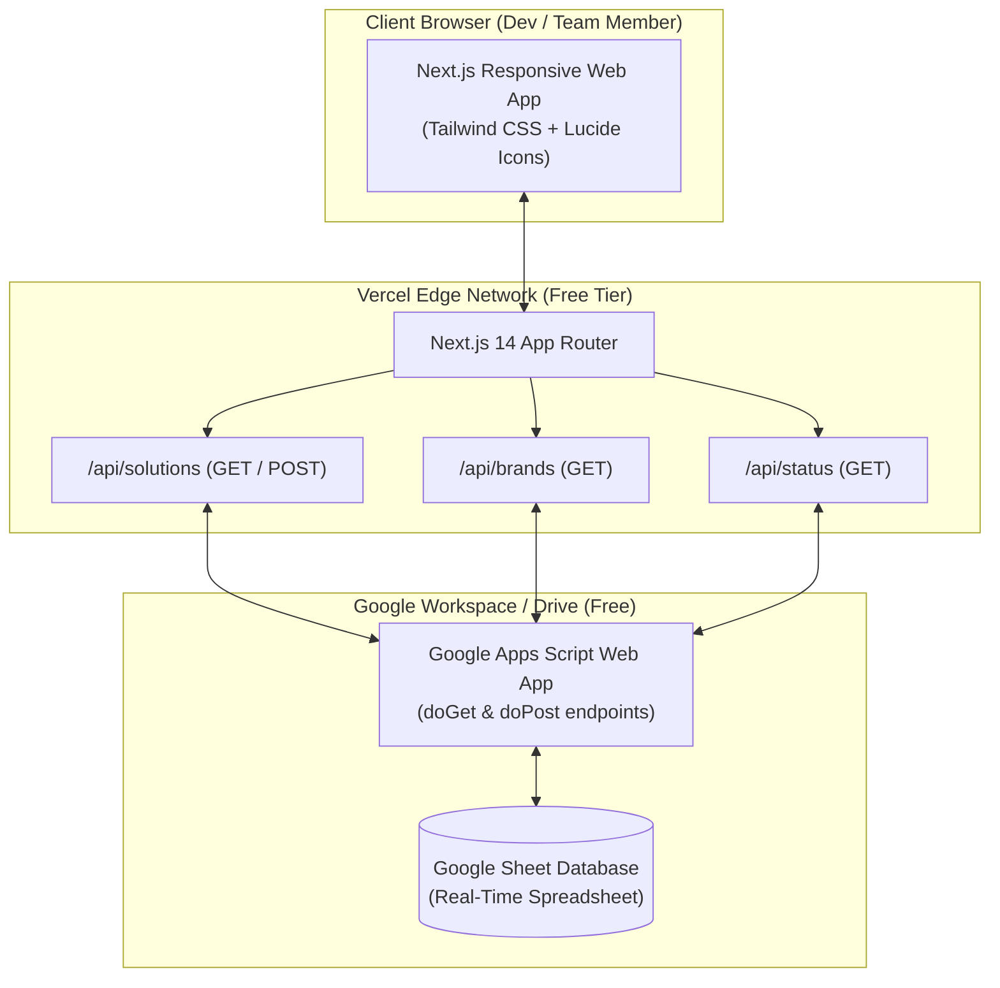

# Shopify Custom Solutions Hub — System Documentation

> **Status:** Production Ready  
> **Repository:** [swathip9898/shopify-solutions-hub](https://github.com/swathip9898/shopify-solutions-hub)  
> **Hosting Cost:** $0 / month (100% Free Architecture)

---

## 1. Executive Summary & Purpose

When managing **60–70 Shopify brand stores**, engineering and merchant support teams constantly invent custom solutions—ranging from Liquid theme tweaks, custom cart validation rules, and Checkout UI extensions to custom Shopify Functions and webhook integrations.

Without a centralized repository:
- Custom code is lost inside individual theme files or private GitHub repos.
- Developers duplicate effort solving problems already fixed for another brand.
- Troubleshooting regressions during Shopify platform updates becomes high-risk because no record exists of which store uses which customization.

The **Shopify Custom Solutions Hub** is a centralized, searchable internal knowledge base and code registry designed specifically to solve this problem. It allows team members to quickly find reusable snippets, inspect brand-specific implementations, and log new solutions in real time.

---

## 2. High-Level Architecture

The system is built on a **modern serverless architecture** that incurs **$0 infrastructure cost**:



### Component Breakdown

| Layer | Technology | Role |
| :--- | :--- | :--- |
| **Frontend** | Next.js 14 (App Router), TypeScript, Tailwind CSS | Ultra-fast client interface, instant search, responsive modals, code syntax presentation. |
| **Backend API** | Next.js Serverless Route Handlers | Secure proxy layer ensuring client browsers never expose internal database logic or private keys. |
| **Database** | Google Sheets + Google Apps Script Web App | Zero-cost relational datastore. Non-technical users can inspect, edit, or back up data directly in Sheets. |
| **Hosting & CI/CD** | Vercel | Automatic deployments triggered upon git push to GitHub `main` branch. |

---

## 3. Data Model & Schema

The system stores all records in a single structured Google Sheet tab named **`Solutions`**.

### Column Schema

| Column Index | Field Name | Type | Description |
| :--- | :--- | :--- | :--- |
| **A** | `id` | `String` | Unique record identifier (e.g. `sol_1730000000000`) |
| **B** | `title` | `String` | Solution title (e.g., *Gift Wrap at Checkout*) |
| **C** | `category` | `Enum` | `liquid`, `checkout_extension`, `shopify_function`, `custom_app`, `metafield`, `integration` |
| **D** | `shopifyVersion` | `String` | `Online Store 2.0`, `Vintage Theme`, or `Checkout Extensibility` |
| **E** | `brand` | `String` | Store / brand name where the solution was implemented |
| **F** | `description` | `String` | Detailed explanation of the business requirement and implementation |
| **G** | `codeSnippet` | `String` | Raw source code (Liquid, JavaScript, Rust, GraphQL, or JSON) |
| **H** | `author` | `String` | Name of the developer or contributor |
| **I** | `dateAdded` | `ISO Date` | Date string (e.g., `2026-10-27`) |
| **J** | `tags` | `Array<String>` | Comma-delimited search keywords (e.g., `cart, checkout, discounts`) |
| **K** | `documentationUrl`| `String (URL)`| External link to Shopify Docs, PR, or internal wiki |
| **L** | `status` | `Enum` | `active`, `deprecated`, or `needs_update` |

---

## 4. Google Apps Script Web App Engine

Instead of requiring complex Google Cloud Service Account JSON keys or OAuth refresh tokens that expire, the system uses a **Google Apps Script Web App** deployed as an execution bridge.

### Core Script Capabilities
- **`doGet(e)`**:
  - Handles `?action=status`: Returns connection confirmation.
  - Handles `?action=solutions`: Reads all data rows, automatically maps headers to JSON objects, and returns the full solutions list.
  - Handles `?action=brands`: Aggregates solutions by `brand` name and dynamically returns store counts and customization categories.
- **`doPost(e)`**:
  - Receives new solution submissions as JSON payloads.
  - Appends a new formatted row directly into the Google Sheet.
  - Generates timestamps and unique IDs if not already supplied.

### Key Deployment Settings
- **Execute as:** `Me (your Google account)`
- **Who has access:** `Anyone` (required so the Vercel serverless functions can post and read data without interactive Google login screens)

---

## 5. Application Features & UI Capabilities

### 1. Central Solutions Directory
- **Instant Search**: Real-time filtering across titles, descriptions, code content, tags, and author names without network round-trips.
- **Multi-Category Filters**: 
  - `All Categories`
  - `Liquid / Theme`
  - `Checkout Extensions`
  - `Shopify Functions`
  - `Custom Apps`
  - `Metafields`
  - `Integrations`
- **Platform Version Filtering**: Filter by *Online Store 2.0* vs *Vintage Themes* vs *Checkout Extensibility*.

### 2. Code Inspector & 1-Click Copy
- Clicking any solution card opens an inspection modal displaying:
  - Formatted, monospace code block with dark syntax theme.
  - **1-Click Copy**: Copies snippet directly to system clipboard with visual confirmation.
  - Metadata badges: Author, Implementation Date, Brand association, and Documentation link.

### 3. Submission Workflow
- Accessible via the **"+ Add Solution"** button.
- Support for selecting an existing brand or typing a new custom brand name.
- Input validation to ensure required fields (title, category, brand, description, code snippet) are provided.
- Once submitted, changes are instantly committed to Google Sheets and immediately visible to the entire team.

### 4. Brands Directory
- Dedicated tab displaying all tracked brands.
- Shows total solution count per brand.
- Clicking a brand filters the solution feed directly to solutions authored for that brand.

---

## 6. Deployment & Environment Configuration

### Step 1: Environment Variable
The application requires only **one** environment variable:

```bash
GOOGLE_SHEET_WEBAPP_URL="https://script.google.com/macros/s/AKfycbxrUd6_SIK4ZvMBCOHHghjLsxyzNoZcHTj-n-MtyD8-a_5c0hNPZb5rz_nLT30hnu74/exec"
```

### Step 2: Deploying to Vercel (Free)
1. Sign in to [Vercel](https://vercel.com) using your GitHub account.
2. Click **New Project** → **Import** `shopify-solutions-hub`.
3. In **Environment Variables**, paste:
   - **Name**: `GOOGLE_SHEET_WEBAPP_URL`
   - **Value**: Your Google Apps Script Web App URL.
4. Click **Deploy**.

### Step 3: Custom Domain (Optional & Free)
1. In your Vercel Project Dashboard, navigate to **Settings** → **Domains**.
2. Add your custom domain (e.g. `solutions.yourcompany.com`).
3. Follow the DNS instructions (CNAME pointing to `cname.vercel-dns.com`). SSL certificates are automatically generated and managed for free.

---

## 7. Data Management & Operations

### Direct Spreadsheet Editing
Because the database is a standard Google Sheet, administrators have complete freedom to:
- **Edit typos or update snippets** directly within the sheet cells. Updates appear immediately upon next page refresh.
- **Delete records**: Simply right-click and delete the row in the spreadsheet.
- **Bulk Import**: Paste existing internal solutions into the sheet following the column schema.

### Backups & Version Control
- **Revision History**: Google Sheets automatically retains detailed revision history under `File` → `Version history`. Any accidental deletion or incorrect change can be rolled back with one click.
- **Offline Exports**: The database can be downloaded anytime as `.xlsx`, `.csv`, or `.pdf` for off-site backups.

---

## 8. Troubleshooting Guide

| Issue | Likely Cause | Solution |
| :--- | :--- | :--- |
| **Status badge shows "Database Ready" instead of "Connected"** | Missing environment variable on Vercel | Add `GOOGLE_SHEET_WEBAPP_URL` to Vercel Project Settings → Environment Variables, then redeploy. |
| **New solutions do not save to the Sheet** | Google Apps Script permissions expired or set to private | Ensure Google Apps Script Web App is deployed with *"Who has access: Anyone"*. If re-editing script code, deploy a **New Version** via `Deploy` → `Manage deployments` → `Edit` → `New version`. |
| **Changes made in sheet are not appearing** | Browser cache or Next.js static cache | Refresh the page. Next.js API routes use dynamic fetching with `cache: 'no-store'` to ensure fresh data on every load. |
